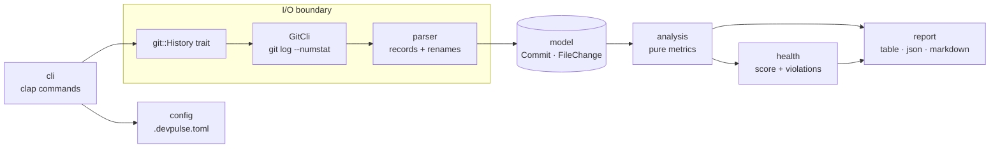
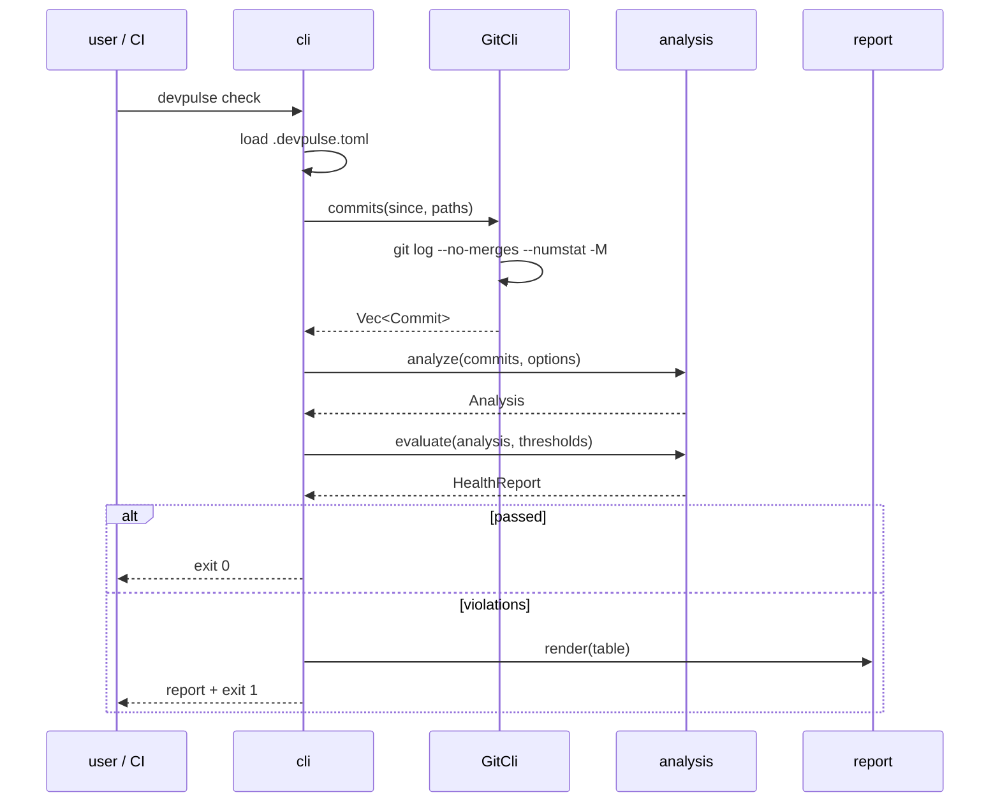

# devpulse

[](https://github.com/jakhongirjp/devpulse/actions/workflows/ci.yml)


Engineering health metrics from git history. devpulse finds the files that
change most and hurt most (hotspots), shows who owns what, computes the
**bus factor**, and turns all of it into a 0–100 health score you can gate CI on.

```text
$ devpulse report --since 2024-01-01 --top 5      # run on the ripgrep repository
devpulse · ripgrep
health score 69/100  ·  bus factor 1

407 commits · 168 authors · 151 files · +14200 −5258 · 2023-12-11 → 2026-11-22 (165 days active)

Hotspots
  file                                commits  churn  owner            owned
  CHANGELOG.md                        56       358    Andrew Gallant   76%
  crates/core/flags/defs.rs           29       1383   Andrew Gallant   60%
  tests/regression.rs                 31       823    Andrew Gallant   48%
  crates/ignore/src/default_types.rs  37       79     Adhvik Kanagala  15%
  crates/globset/src/lib.rs           21       688    Thayne McCombs   39%
...
```

## Why

Engineering managers and staff engineers keep asking the same questions:
*Where is the risk in this codebase? What happens if one person leaves? Which
files should we refactor first?* The answers are already in git. devpulse
reads them in seconds, with no server, no account and no data leaving the
machine.

## Features

- **Hotspots**: change frequency × size (`commits × ln(1 + churn)`), the
  metric popularised by *Your Code as a Crime Scene*.
- **Ownership**: primary author per file and how much of it they wrote.
- **Bus factor**: the smallest group of people who own more than half of the
  files.
- **Health score and CI gate**: `devpulse check` exits `1` when thresholds are
  broken, so a team can fail a pipeline when knowledge concentrates.
- **Three outputs**: terminal table, JSON for dashboards, Markdown for PR
  comments and job summaries.
- Follows renames, honours `.mailmap`, skips merges, excludes lockfiles and
  generated code by default.

## Install

```bash
cargo install --git https://github.com/jakhongirjp/devpulse
# or download a prebuilt binary from Releases (Linux, macOS, Windows)
```

## Usage

```bash
devpulse report                                   # table for the current repo
devpulse report --format json --since 2026-01-01  # machine-readable
devpulse report --format markdown --path src/     # restrict to a subtree
devpulse init                                     # write .devpulse.toml
devpulse check                                    # exit 1 if thresholds fail
```

Exit codes: `0` success, `1` check failed, `2` usage or runtime error.

### Configuration

```toml
# .devpulse.toml
exclude = ["**/*.lock", "**/package-lock.json", "**/vendor/**", "**/dist/**", "**/*.min.js"]

[check]
min_score = 60
min_bus_factor = 2
max_hotspot_share = 0.25   # top file may hold at most 25% of all churn
max_days_since_commit = 90
```

### GitHub Action

```yaml
- uses: actions/checkout@v4
  with: { fetch-depth: 0 }      # full history is required
- uses: jakhongirjp/devpulse@v0.1.0
  with: { command: check }
```

## Health score

| Component | Weight | Full marks when |
|---|---:|---|
| Knowledge spread | 40 | bus factor ≥ 4 |
| Churn concentration | 30 | no single file dominates churn |
| Recency | 30 | last commit today; zero after 180 days |

The formula lives in `src/analysis/health.rs` and is covered by unit tests,
so changes to it are deliberate and reviewed.

## Architecture



Only `git::GitCli` touches the outside world. Everything after it is pure
functions over plain data, which is why the analysis is tested with in-memory
commits and the binary is tested end to end against real temporary
repositories.



## Development

```bash
cargo test                      # unit + end-to-end tests
cargo clippy --all-targets -- -D warnings
cargo fmt --check
```

CI runs lint, tests on Linux, macOS and Windows, an MSRV check, and runs
devpulse on its own history into the job summary. Tagging `v*` builds
release binaries for five targets with SHA-256 checksums.

## Design decisions

- [ADR-0001: Shell out to git instead of linking libgit2](docs/adr/0001-shell-out-to-git.md)
- [ADR-0002: Pure analysis core with a single I/O boundary](docs/adr/0002-pure-analysis-core.md)

## Roadmap

- Temporal coupling: files that always change together
- Per-directory ownership and team mapping via CODEOWNERS
- Trend mode comparing two periods
- Incremental cache for very large monorepos

## Documentation

| Document | Contents |
|---|---|
| [Product](docs/product.md) | Vision, business problem, business and technical requirements, workflows |
| [Engineering](docs/engineering.md) | Boundaries, security, performance, observability, DR, DevOps, testing |
| [Roadmap](docs/roadmap.md) | Ten milestones and the release plan |
| [CTO review checklist](docs/cto-review-checklist.md) | Honest status against production-readiness criteria |
| [ADRs](docs/adr) | Architecture decisions |
| [Contributing](CONTRIBUTING.md) | Branching, commits, labels, board, releases |

## License

MIT
