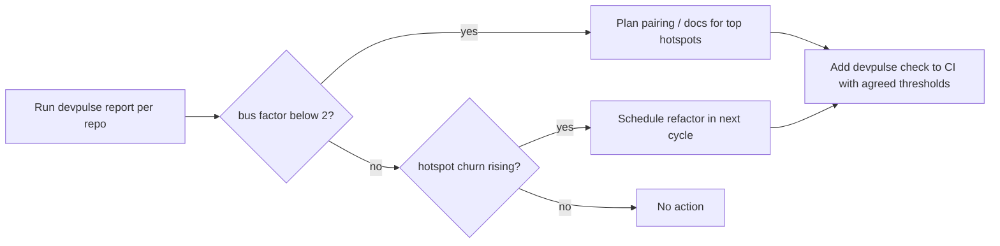

# Product: vision and requirements

## Vision

Engineering leaders make staffing and refactoring decisions on gut feel because
the data is locked in git history and nobody has time to dig. devpulse turns a
repository's history into a one-screen answer to three questions: *where is the
risk, who holds the knowledge, and is it getting better?* It runs locally or in
CI in seconds, needs no server or account, and sends no code anywhere.

**Who it's for.** Engineering managers and staff engineers preparing a
planning cycle, a reorg or a due-diligence review; teams that want a health gate
in CI.

## Business problem

| Today | Cost |
|---|---|
| Key-person risk discovered when the person resigns | Weeks of lost velocity, incidents in code nobody understands |
| Refactoring chosen by who complains loudest | Effort spent on code that rarely changes |
| SaaS analytics tools | Need repository access for a third party: a security review, a contract and a monthly bill |

## Business requirements

| ID | Requirement |
|---|---|
| BR-1 | Identify the files that change most and carry the most churn. |
| BR-2 | Show who owns each hotspot and how concentrated ownership is. |
| BR-3 | Report a bus factor: the fewest people who are primary owners of more than half the files. |
| BR-4 | Summarise health as one score with a transparent formula. |
| BR-5 | Gate CI on thresholds the team chooses. |
| BR-6 | Work offline on any repository, with no data leaving the machine. |

## Technical requirements

| ID | Requirement | How it is met |
|---|---|---|
| TR-1 | Read real history accurately | Parses `git log --numstat` with explicit field separators; renames and binary files handled; tested against generated repositories |
| TR-2 | Fast on large repos | Single pass over `git log` output; 2,380 commits of ripgrep analysed in well under a second on a laptop |
| TR-3 | Cross-platform | CI on Linux, macOS and Windows; release binaries for five targets |
| TR-4 | Scriptable | `table`, `json` and `markdown` output; documented exit codes (`0`, `1` check failed, `2` error) |
| TR-5 | Configurable without flags | `.devpulse.toml` for thresholds and exclude patterns |
| TR-6 | Usable in CI with no install | Docker-based GitHub Action |

## Out of scope

Code quality metrics (complexity, coverage), which linters already provide;
judging individual developer productivity, which this tool is deliberately not
designed for.

## Business workflow: quarterly risk review

